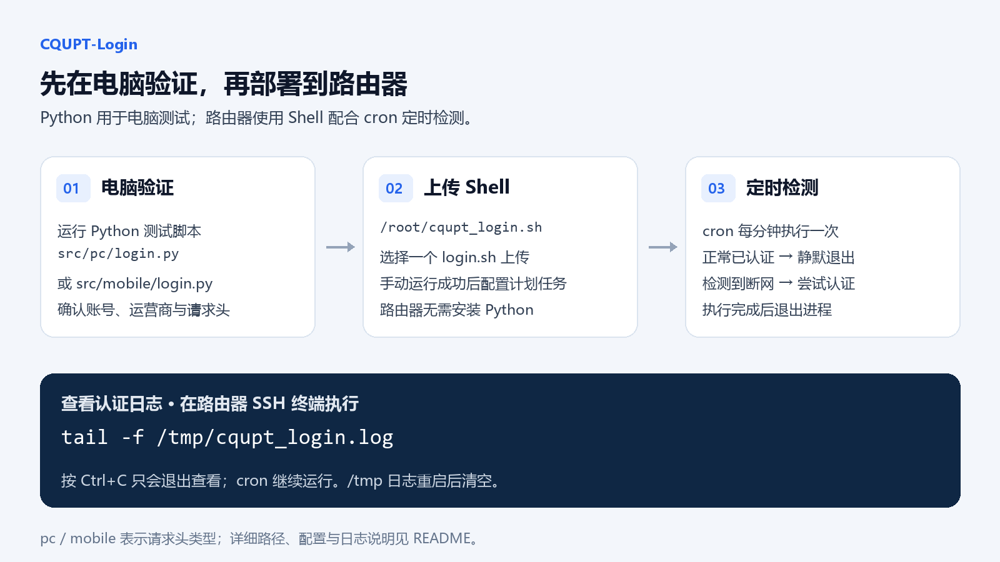

# CQUPT-Login

> 本项目仅供学习与技术交流，使用前请阅读文末的[免责声明](#免责声明)。

重庆邮电大学校园网自动认证脚本，通过 eportal 接口提交登录信息，并在检测到外网不可用时重新认证。项目提供电脑端、手机端两组请求头：在电脑上用 Python 测试认证是否正常，再将 Shell 脚本部署到 ImmortalWrt / OpenWrt 路由器。

脚本需要先连接校园网，并能够访问认证服务器。重新认证用于恢复校园网登录状态，不负责重新连接 Wi-Fi 或拨号。

## 认证请求与密码传输说明

本项目当前使用的重邮校园网 HTTP 认证接口，通过 GET 请求提交账号密码，`user_password` 参数中包含原始密码值，未进行额外的应用层加密；同时，HTTP 连接未使用 HTTPS / TLS 加密。因此，在本项目所使用的认证流程中，密码以明文形式传输。

这种直接的参数形式便于观察和分析认证请求，也为修改代码、调试参数和复现认证流程提供了便利。需要区分的是，URL 编码只是参数的表示方式，并不等同于加密。调试或分享请求记录时，请隐藏真实账号密码。

## 部署方式与资源开销

为减少路由器的运行与存储开销，本项目在路由器端采用 **Shell + 固件已有工具 + cron**。每次执行完成检测及必要的认证后退出，无需额外安装 Python 解释器和 `requests`，也无需让 Python 进程在路由器上常驻。

**Python 脚本仅用于在电脑上测试账号、运营商和请求头是否能正常认证及访问外网。** 虽然测试脚本自带循环和重连逻辑，正式路由器部署仍使用 Shell 版本。`requirements.txt` 仅用于电脑测试环境，路由器不用安装其中的依赖。



## 使用顺序

1. 在电脑上修改 Python 配置，尽量换成自己设备实际认证时的请求头，确认能够正常连接。
2. 将相同的账号信息及已验证的请求头同步到选择的 Shell 脚本。
3. 上传到路由器 `/root/cqupt_login.sh`，手动执行成功后，再设置每分钟运行一次。
4. 通过 `/tmp/cqupt_login.log` 查看认证日志；请求头参考见 [设备 UA 与替换方法](docs/USER_AGENTS.md)。

## 项目结构

```text
CQUPT-Login/
├── README.md
├── requirements.txt
├── docs/
│   ├── USER_AGENTS.md
│   └── images/
│       └── deployment.png
└── src/
    ├── mobile/
    │   ├── login.py
    │   └── cqupt_login.sh
    └── pc/
        ├── login.py
        └── cqupt_login.sh
```

| 脚本 | 请求头 | 运行方式 |
| --- | --- | --- |
| [src/pc/login.py](src/pc/login.py) | Windows / Edge | 在电脑上运行，测试电脑端认证与重连 |
| [src/mobile/login.py](src/mobile/login.py) | Android / 小米浏览器 | 在电脑上运行，测试手机端请求头 |
| [src/pc/cqupt_login.sh](src/pc/cqupt_login.sh) | curl 使用电脑端请求头；wget 回退使用通用 User-Agent | 单次执行，配合 crontab 定时运行 |
| [src/mobile/cqupt_login.sh](src/mobile/cqupt_login.sh) | Android / 小米浏览器 | 单次执行，配合 crontab 定时运行 |

`pc` / `mobile` 表示认证设备类型及其请求头：电脑端固定使用前缀 `0`，手机端固定使用前缀 `1`，并不表示脚本必须在对应设备上运行。只修改 UA 不会自动改变固定前缀；切换认证设备类型时应选择对应目录的脚本。路由器按已在电脑上验证成功的请求类型，选择一份 Shell 脚本部署。两个 Shell 脚本默认共用锁文件、状态文件和日志文件，不应同时安排运行。

## 路由器部署：ImmortalWrt / OpenWrt

Shell 脚本面向提供 `/bin/sh` 的固件，依赖支持 `ip route get` 的 `ip` 命令，以及 `grep`、`awk`、`head`、`cut`、`tee`、`date` 等常见工具。HTTP 请求优先使用 `curl`，未安装时回退到支持脚本所用 `--header` 参数的 `wget`。不同固件的工具功能可能不同，先手动运行确认。

### 1. 选择脚本并修改配置

选择 `src/pc/cqupt_login.sh` 或 `src/mobile/cqupt_login.sh` 中需要部署的一份。两份 Shell 现在与 Python 使用相同的账号、密码和运营商配置名，不再手填完整的认证账号：

```sh
USERNAME="你的校园网账号"
PASSWORD="你的校园网密码"
# 运营商选择：移动 cmcc；电信 telecom；联通 unicom
OPERATOR="unicom"
```

`USERNAME` 只填写账号本身，`PASSWORD` 填写密码，`OPERATOR` 从 `cmcc`、`telecom`、`unicom` 中选择。Shell 变量名与等号之间不要加空格。无效运营商会输出错误提示并退出。

Shell 其他配置与 Python 的变量名有所不同：

| Shell 配置项 | 当前默认值 / 用途 |
| --- | --- |
| `BASE_URL` | `http://192.168.200.2:801`，认证服务器 |
| `LOGIN_PATH` | `/eportal/`，与 `BASE_URL` 拼接为完整认证接口 |
| `CHECK_URL` | `http://www.baidu.com`，外网检测地址 |
| `LOG_FILE` / `LOCK_FILE` / `STATE_FILE` | 日志、进程锁和在线状态文件，默认路径见后文 |

### 账号拼接规则

前缀由认证设备类型决定，运营商只决定 `@` 后的后缀。四份脚本均采用以下规则，不再使用运营商前缀映射字典：

| 运营商 | `OPERATOR` | 电脑端 `pc` | 手机端 `mobile` |
| --- | --- | --- | --- |
| 中国移动 | `cmcc` | `,0,账号@cmcc` | `,1,账号@cmcc` |
| 中国电信 | `telecom` | `,0,账号@telecom` | `,1,账号@telecom` |
| 中国联通 | `unicom` | `,0,账号@unicom` | `,1,账号@unicom` |

Shell 在登录函数中自动生成 `USER_ACCOUNT`。配置区不再使用旧的 `USER_ACCOUNT` / `USER_PASSWORD`，密码配置统一为 `PASSWORD`。从旧版升级时，请将个人配置迁移到新变量中。

请求头也请尽量替换为自己的已验证值，具体位置和样例见 [设备 UA 与替换方法](docs/USER_AGENTS.md)。手机端 Shell 修改 `MOBILE_UA`；电脑端 Shell 当前需要同时修改 curl 的 `-A` 和 wget 的 `User-Agent` 参数。

### 2. 脚本放在哪个位置

将选中的 `src/mobile/cqupt_login.sh` 或 `src/pc/cqupt_login.sh` 上传到路由器，统一部署为：

```text
/root/cqupt_login.sh
```

`/root` 是本项目采用的部署位置，并非系统强制规定。正常的持久化固件中，脚本通常能在普通重启后保留；不要把唯一的脚本副本放在重启会清空的 `/tmp` 中。若使用其他持久化路径，定时任务中的路径也要同步修改。

| 路由器上的位置 | 用途 |
| --- | --- |
| `/root/cqupt_login.sh` | 上传并配置后的脚本 |
| `/etc/crontabs/root` | root 用户的计划任务配置，由 `crontab -e` 或 LuCI 修改 |
| `/tmp/cqupt_login.log` | 脚本的认证日志，重启后不保留 |
| `/tmp/cqupt_login.lock` | 记录执行进程，减少重复执行 |
| `/tmp/cqupt_authed` | 记录已认证状态，断网时清除 |

可通过支持路由器的文件传输工具上传，也可从电脑终端使用 SCP。以下以项目根目录中的手机端 Shell 为例，`192.168.1.1` 仅是路由器管理 IP 示例，请替换成实际值；它与校园网认证服务器 `192.168.200.2` 不同。

```sh
scp -O src/mobile/cqupt_login.sh root@192.168.1.1:/root/cqupt_login.sh
ssh root@192.168.1.1
```

电脑端请求头版本将上传路径换成 `src/pc/cqupt_login.sh`。`-O` 使用传统 SCP 传输，适用于未提供 SFTP 的固件；如果本机 SCP 不支持此选项，可使用不带 `-O` 的命令或其他传输工具。

### 3. 在路由器上手动运行

下面的命令均在路由器的 SSH 终端执行。脚本保存为 UTF-8、无 BOM、LF 换行；从 Windows 上传后，可先去除行尾的 CR 字符：

```sh
sed -i 's/\r$//' /root/cqupt_login.sh
chmod 700 /root/cqupt_login.sh
sh -n /root/cqupt_login.sh
/root/cqupt_login.sh
```

`sh -n` 只检查 Shell 语法。最后一行才会真正发起检测及必要的认证。每次运行完成后退出，后续重复检测由 cron 负责，不需要再加 `while true` 或后台常驻命令。

### 4. 设置计划任务

先确认手动执行能够正常认证。可在 LuCI 的“系统 → 计划任务（System → Scheduled Tasks）”中添加下面一行，保存时保留末尾换行；也可通过 SSH 运行 `crontab -e` 编辑。两种方式选择一种即可，不要重复添加。

```cron
* * * * * /root/cqupt_login.sh >/dev/null 2>&1
```

在路由器 SSH 终端启用并重启 cron，然后检查任务内容：

```sh
/etc/init.d/cron enable
/etc/init.d/cron restart
crontab -l
```

`enable` 配置 cron 随系统启动，`restart` 使服务运行并重新应用配置。这里是每分钟检测一次；外网正常且存在已认证状态文件时，脚本静默退出；外网不可用时，清除状态并尝试重新认证。下一轮由 cron 触发，实际发现断网可能需等待下一分钟，再加上请求耗时。

Shell 不使用 Python 的 60 秒 / 5 秒配置项。计划任务设置方式可参考 [OpenWrt 官方 cron 文档](https://openwrt.org/docs/guide-user/base-system/cron)，服务操作可参考 [官方服务管理说明](https://openwrt.org/docs/guide-user/base-system/managing_services)。

### 5. 如何查看日志

在路由器 SSH 终端执行：

```sh
# 查看最近 50 行
tail -n 50 /tmp/cqupt_login.log

# 持续观察新增日志，按 Ctrl+C 退出查看
tail -f /tmp/cqupt_login.log

# 查看现有全部日志
cat /tmp/cqupt_login.log
```

退出 `tail -f` 只停止查看，不会停止 cron。脚本的 `log()` 通过 `tee -a` 同时输出到终端并追加到 `LOG_FILE`；定时任务中的 `>/dev/null 2>&1` 只丢弃终端输出，不会阻止脚本写入自己的日志文件。

可能出现的内容包括“网络断开，准备重新认证”“发起认证”“响应”“认证成功”“已在线”或“认证失败”。网络正常且之前已认证时，脚本静默退出，因此日志长时间没有新增不一定代表没有执行。

**认证日志和系统调度日志是两回事。** 本脚本没有通过 `logger` 主动写入系统日志，LuCI 的系统日志页面未必展示 `/tmp/cqupt_login.log` 内容。排查 cron 是否调度时，可辅助执行：

```sh
logread -e cron
```

系统是否记录每次调度取决于固件和 cron 日志设置。认证结果请以 `LOG_FILE` 指定的文件为准；没有日志文件时，先手动运行脚本并查看终端输出。请确认实际脚本没有修改 `LOG_FILE` 路径。

日志、锁和在线状态文件默认位于 `/tmp`。这避免持续写入路由器闪存，但会占用内存，重启后清空；当前脚本未实现自动日志轮转。排查完成后，如需清空已有日志内容，可在路由器上执行：

```sh
: > /tmp/cqupt_login.log
```

## 电脑测试：Python 版本

这两份 Python 脚本均用于电脑测试。选择 `pc` 或 `mobile` 会同时选择固定的认证设备前缀和对应请求头；路由器端按前面的 Shell 方案部署。

### 1. 安装依赖

准备 Python 3 和 pip，下载项目后进入包含 `requirements.txt` 的项目根目录。

Windows：

```powershell
python -m pip install -r requirements.txt
```

Linux / macOS：

```sh
python3 -m pip install -r requirements.txt
```

`requirements.txt` 中仅包含 `requests`。`re`、`socket`、`time`、`logging`、`sys`、`json` 和 `urllib.parse` 都是 Python 标准库，无需单独安装。

### 2. 修改配置

打开准备运行的 `src/pc/login.py` 或 `src/mobile/login.py`，修改文件顶部的配置区：

```python
USERNAME = "你的校园网账号"
PASSWORD = "你的校园网密码"
# 运营商选择：移动填 "cmcc"；电信填 "telecom"；联通填 "unicom"
OPERATOR = "cmcc"
AUTH_URL = "http://192.168.200.2:801/eportal/"
KEEP_ALIVE_INTERVAL = 60
RETRY_INTERVAL = 5
TEST_URL = "http://www.baidu.com"
```

| 配置项 | 用途 |
| --- | --- |
| `USERNAME` | 校园网账号，只填账号本身，不添加前缀或运营商后缀 |
| `PASSWORD` | 校园网密码 |
| `OPERATOR` | 移动填写 `"cmcc"`，电信填写 `"telecom"`，联通填写 `"unicom"` |
| `AUTH_URL` | 完整认证接口地址 |
| `KEEP_ALIVE_INTERVAL` | 外网检测成功后，进入下一轮检测前的等待时间，默认 60 秒 |
| `RETRY_INTERVAL` | 外网检测失败或主循环发生异常后，进入下一轮前的等待时间，默认 5 秒 |
| `TEST_URL` | 用于检测外网连通性的 HTTP 地址 |

Python 直接拼接账号：电脑端使用 `f",0,{USERNAME}@{OPERATOR}"`，手机端使用 `f",1,{USERNAME}@{OPERATOR}"`，详见前面的[账号拼接规则](#账号拼接规则)。

例如，`USERNAME = "1234567"`、`OPERATOR = "telecom"` 时，电脑端提交 `,0,1234567@telecom`，手机端提交 `,1,1234567@telecom`。请填写英文运营商值，不要填写中文名称，也不要在 `USERNAME` 中重复添加前后缀。

Python 的请求参数 `v` 通过 `str(int(time.time() * 1000) % 10000)` 自动生成；Shell 则沿用随机值及原有回退逻辑，二者生成方式不同，均无需手动填写。

### 3. 启动脚本

在项目根目录执行其中一个命令。

Windows 电脑端：

```powershell
python src/pc/login.py
```

Linux / macOS 电脑端：

```sh
python3 src/pc/login.py
```

使用手机端请求头时，将路径换为 `src/mobile/login.py`：

```sh
python3 src/mobile/login.py
```

Windows 可将上述命令中的 `python3` 换为 `python`。脚本需要保持运行，按 `Ctrl+C` 停止。

### 4. 自动认证流程

1. 启动后先尝试一次认证。
2. 访问 `TEST_URL` 检测外网，检测请求超时为 3 秒，最终 HTTP 状态码为 `200` 时判为可访问。
3. 外网可访问且已有认证状态时，静默等待；没有认证状态时，尝试认证。随后等待 `KEEP_ALIVE_INTERVAL` 秒。
4. 外网不可访问时，清除本地在线状态，尝试重新认证，随后等待 `RETRY_INTERVAL` 秒进入下一轮。
5. 主循环发生异常时记录日志，并等待 `RETRY_INTERVAL` 秒后继续。

认证请求超时为 10 秒。以上间隔是每轮的等待时间，实际一轮还包括网络请求耗时。当前代码在“外网检测成功，但认证失败”的分支仍等待 `KEEP_ALIVE_INTERVAL`，并非所有认证失败都使用 5 秒间隔。

### 5. 日志

Python 版本默认使用 `INFO` 级别向终端输出日志，没有配置日志文件。断网、重新认证、认证结果和请求异常都会输出；正常在线状态使用 `DEBUG` 级别，默认不显示。

可能看到的日志内容：

```text
⚠️ 外网断开，重置认证状态
🔄 正在尝试重新认证...
✅ 认证通过! | 状态码: 1 | 提示: ... | IP: ...
```

“重置认证状态”仅在之前处于已认证状态时输出。若需要同时保存标准输出和错误输出，可使用终端重定向，例如：

```sh
python3 -u src/pc/login.py >> cqupt_login.log 2>&1
```

## 替换请求头

请尽量将默认请求头替换为自己实际认证设备的请求头，并先在电脑上验证。已整理小米 6、小米 10、小米 17、OPPO A5、iPhone 17，以及 Windows 10 / 11、Mac、Linux 的 UA 参考和替换位置：

**[查看设备 User-Agent 样例、来源及替换方法](docs/USER_AGENTS.md)**

其中部分为构造或通用格式样例，并非逐台实机抓包。现代浏览器可能隐藏机型和系统版本，不能仅靠修改机型字符串就视为真实设备请求头；最终以自己的认证请求和实际连接结果为准。

## 联通运营商支持情况

电脑端、手机端的 Python 和 Shell 脚本均已加入联通选项，配置 `OPERATOR="unicom"`（Python 写为 `OPERATOR = "unicom"`）即可。电脑端拼接 `,0,账号@unicom`，手机端拼接 `,1,账号@unicom`。

联通电脑端已获得包含 `result: "1"` 和“认证成功”提示的响应抓包；手机端已获得 `,1,账号@unicom` 的请求抓包，但已提供的响应截图正文为 gzip 压缩内容，尚不能仅凭 HTTP 200 确认其业务认证结果。脚本已做离线拼接检查，路由器上的 Shell 联通认证仍需实际测试。

### 如何判断认证成功

HTTP `200 OK` 表示请求返回，不能单独作为认证成功依据。已提供的电脑端电信和联通成功响应均可解码为以下形式：

```text
dr1003({"result":"1","msg":"认证成功"})
```

Python 会解析 JSONP，按 `result` 或成功提示判断；上面的字符串 `"1"` 响应可通过“认证成功”提示被现有代码识别。Shell 则使用文本匹配识别 `result=1`（含字符串形式），并保留已有的“已在线”兼容分支，包括 `ret_code=2`。两种实现的判断细节并非完全相同，排查时应查看实际响应内容及外网访问结果。

欢迎提供不同设备和运营商的脱敏认证请求及成功响应，补充验证范围。抓包思路见[获取自己的真实认证请求](docs/USER_AGENTS.md#获取自己的真实认证请求)。

## 常见问题

### 提示找不到 requests

使用运行脚本的同一个 Python 解释器安装依赖：

```sh
python -m pip install -r requirements.txt
```

如果运行时使用的是 `python3`，安装时也改用 `python3 -m pip`。

### 认证失败或无法获取本机 IP

确认设备已连接校园网，并能访问认证服务器；检查账号、密码和运营商配置。Python 和 Shell 的 `USERNAME` 都只填写账号，`PASSWORD` 填写密码，`OPERATOR` 选择运营商。完整认证字符串由脚本自动拼接，设备前缀取决于所选的 `pc` / `mobile` 脚本。

### 修改认证服务器地址后仍有请求指向旧地址

当前 Python 的 `get_local_ip()` 以及 Shell 的 `ip route get` 仍使用固定的 `192.168.200.2`。服务器地址变化时，需要同步修改这些位置。手机端 Python 的 `Referer` 也为固定地址，电脑端 Python 则由 `AUTH_URL` 生成。

### 显示外网正常，但浏览器仍跳转到登录页

当前检测主要依赖 HTTP 请求结果，Python 还会跟随重定向。认证页最终返回 `200` 时可能被误判为外网可用；请结合浏览器实际访问结果和认证响应日志判断。

### Shell 密码包含特殊字符时认证失败

Shell 版本直接将账号密码拼接到 URL，未进行 URL 编码。密码中的 `&`、`#`、`+` 等字符可能影响请求含义。Python 版本使用 `requests` 的 `params` 参数构造请求，会处理参数编码。

### 修改运营商后仍未重新认证

Python 可停止后重新启动；Shell 可删除状态文件后手动执行一次：

```sh
rm -f /tmp/cqupt_authed
/root/cqupt_login.sh
```

上述路径对应默认的 `STATE_FILE` 配置。

## 免责声明

本项目仅供学习、研究与技术交流使用。使用者应自行确认其使用行为符合相关法律法规，以及所在学校和网络服务提供方的管理规定，并仅在获得合法授权的环境中使用。

本项目按“现状”提供，不保证其功能、稳定性或兼容性。因使用、修改或部署本项目产生的账号异常、网络中断、数据损失及其他后果，由使用者自行评估并承担。在法律允许的范围内，本项目作者、原作者及贡献者不承担由此产生的相关责任。

使用本项目前，请充分了解其工作原理及可能产生的影响；如不同意上述说明，请勿使用。
